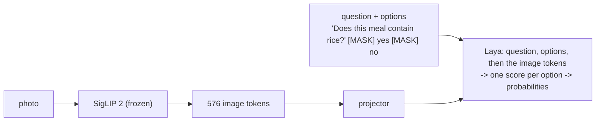

# LayaMacro

**One photo of a meal → calories, protein, carbohydrate, fat and food weight, each with an
honest uncertainty range, and answers to questions about the food.**

LayaMacro grafts an image encoder (SigLIP 2) onto [Laya](https://huggingface.co/convaiinnovations/laya),
an encoder-only *typed decision* model. Every answer is a probability distribution over the
answer options, read in one forward pass, with no generated text: the nutrition questions
("How many kilocalories…?" over 18 ranges) and food questions ("Does this meal contain
rice?", "Which of these foods is on the plate?") go through the same mechanism.

```
$ python scripts/infer/predict.py --weights weights/layamacro-laya.pt meal.png \
      --ask "Does this meal contain chicken?" --options yes no --over kcal=500

meal.png                                            true (weighed)
  energy          235.8 kcal (80 % range: 154-341)     276 kcal
  protein          29.1 g    (80 % range: 22-40)        52 g   <- outside the range
  carbohydrate      0.5 g    (80 % range: 0-2)           0 g
  fat              10.7 g    (80 % range: 2-26)          6 g
  food weight     145.9 g    (80 % range: 101-192)     167 g
  P(energy > 500 kcal) = 0%                              no
  Does this meal contain chicken? -> yes (yes 100%, no 0%)   yes
```

A Nutrition5k test dish the model never saw, chosen by a fixed rule: among test meals of
200-400 kcal, the one whose calorie error is closest to the median error (40 kcal). The "true"
column is not printed by the tool; it is the dataset's weighed label.

> **Research project, not a medical device.** Average calorie errors are 48-63 kcal per meal on
> Nutrition5k and DFood-TJ test photos, 170 kcal on NutritionVerse-Real's larger meals, and
> worse on unfamiliar kinds of photos (Limitations).

## Results at a glance

Full tables, methods and negative results: [docs/results.md](docs/results.md).

**Nutrition** (kcal mean absolute error, lower is better):

| model | Nutrition5k | never-seen meals | DFood-TJ (hospital trays) | NutritionVerse-Real (phone) |
|---|---|---|---|---|
| **LayaMacro** (released checkpoint) | 48.5 | 62.7 | **63.1** | **169.9** |
| OmniFood8K (CVPR 2026, official weights)* | **36.8** | **50.5** | 168.9 | 639.3 |
| FoodLMM (7B, official weights)* | 48.6 | 66.2 | 209.3 | 684.7 |
| Gemma 4 E2B, untrained | 310.0 | 247.3 | 240.9 | 510.9 |

\* Run by us on the same test photos; trained by their authors on Nutrition5k only, so the
last two columns are transfer to new kinds of photos for them. On Nutrition5k itself,
OmniFood8K is clearly better.

**Food questions** (accuracy on test photos; chance: ~0.56 for yes/no, 0.20 for 1-of-5):

| model | "Contains X?" | "Contains X?", unseen wording | "Which of these 5 foods?" |
|---|---|---|---|
| **LayaMacro** (released checkpoint) | **0.89** | **0.88** | **0.86** |
| Qwen3.5-2B, untrained | 0.80 | 0.79 | 0.62 |
| Gemma 4 E2B, untrained | 0.74 | 0.68 | 0.52 |

For the 243 foods it was trained on (`--foods`). For food names it never saw, an untrained VLM
does better (0.83 vs 0.65): see Limitations.

## How it works



The image tokens go *after* the question and options, so Laya's answer positions never move
(details and the other pitfalls: [docs/laya.md](docs/laya.md)). Nutrition is five `score`
questions over 18 ranges each; the estimate is the distribution's mean and the range its
central 80 %. Full description: [docs/architecture.md](docs/architecture.md).

## Install

Python 3.12, [uv](https://docs.astral.sh/uv/), a CUDA GPU recommended (CPU works, slowly).

```bash
git clone https://github.com/Aquos06/LayaMacro && cd LayaMacro
uv sync                      # inference only
uv sync --extra train        # + training and benchmarks
```

## Use it

Weights (108 MB, CC BY-NC-SA 4.0, see [MODEL_LICENSE.md](MODEL_LICENSE.md)):
[Aquos06/LayaMacro](https://huggingface.co/Aquos06/LayaMacro). Laya and SigLIP 2 are
downloaded from their official sources on first use.

```bash
W=hf://Aquos06/LayaMacro/layamacro-laya.pt
uv run python scripts/infer/predict.py --weights $W meal.jpg                       # nutrition
uv run python scripts/infer/predict.py --weights $W meal.jpg --over kcal=500 fat_g=20
uv run python scripts/infer/predict.py --weights $W meal.jpg \
    --ask "Which of these foods is on this plate?" --options rice noodles bread potato salad
uv run python scripts/infer/predict.py --weights $W --foods                        # known foods
```

```python
from layamacro.inference import load_predictor

model = load_predictor("hf://Aquos06/LayaMacro/layamacro-laya.pt")
model.predict(["meal.jpg"])                     # {"kcal": {"value", "low", "high"}, ...}
model.prob_over(["meal.jpg"], "kcal", 500)      # e.g. [0.03]; calibrated
model.ask(["meal.jpg"], "Does this meal contain rice?", ["yes", "no"])
model.foods                                     # the 243 food names it was trained on
```

**Which questions work well:** "Does this meal contain *X*?" and "Which of these foods is on
this plate?" for foods in `model.foods`, phrased freely (an unseen wording scored 0.88); up to
8 options. For "over N kcal / grams", use `--over` / `prob_over`: it is calibrated.
Questions about other foods or other topics are answered, but weakly.

## Train

```bash
# 1. data (see docs/datasets.md for licences)
uv run python scripts/data/download_nutrition5k.py
uv run python scripts/data/download_dfood_tj.py
uv run python scripts/data/download_nutritionverse.py   # needs a Kaggle API token

# 2. cache SigLIP 2's output once
uv run python scripts/data/cache_features.py

# 3. train the released recipe: nutrition + food questions, 2 GPUs, ~8.3 h on 2x RTX 4060 Ti
uv run torchrun --nproc_per_node 2 scripts/train/train_laya.py --scope head --no-resampler \
    --images-per-batch 1 --epochs 10 --multitask --seed 0

# 4. release checkpoint (adds calibration temperatures, bins and the food list)
uv run python scripts/export_weights.py --run runs/laya_s0 --out weights/my-laya.pt
```

The recipe is **unstable across seeds** (see Limitations): check the food-question benchmark
before using a run.

## Benchmark

```bash
uv run python scripts/benchmark/evaluate.py         # nutrition, every run on every test set
uv run python scripts/benchmark/question_bank.py --bank --run runs/<run>   # food questions
uv run python scripts/data/download_benchmark_datasets.py fpb lefood
uv run python scripts/benchmark/unseen.py           # datasets no model trained on
uv run python scripts/benchmark/vlm.py --model gemma4-e2b   # an untrained VLM baseline
```

## Limitations

- **Portion size from one photo is guessed, not measured.** On unfamiliar photos every model
  we tested, ours included, predicts the portion sizes of its training data.
- **Uncertainty ranges are too narrow on unfamiliar photos**: they hold the truth 13-23 % of
  the time there, against 79-92 % on the training datasets' test photos.
- **Food recognition is limited to the 243 trained foods.** For food names it never saw it is
  barely better than chance (0.65 on yes/no, 0.40 on 1-of-5), where an untrained Qwen3.5-2B
  scores 0.83 / 0.55.
- **Training is unstable**: the same recipe with another random seed failed to learn the
  food questions. The released checkpoint is the seed that worked, verified on the benchmark.
- **Food questions cost some calorie accuracy**: the same recipe without food questions
  averages 46.0 kcal on Nutrition5k (2 seeds), with them 49.1 (2 seeds; released seed 48.5).
- Trained on US cafeteria dishes, Chinese hospital meals and phone photos of mostly Western
  food. Other cuisines and settings are unfamiliar to it.

## Contributing

Bug reports, reproductions (especially other seeds) and reports of poor predictions are
welcome: see [CONTRIBUTING.md](CONTRIBUTING.md). Report security problems privately
([SECURITY.md](SECURITY.md)). Everyone taking part follows the
[Code of Conduct](CODE_OF_CONDUCT.md).

## Licence and credits

- **Code**: Apache License 2.0 ([LICENSE](LICENSE)).
- **Weights**: CC BY-NC-SA 4.0, non-commercial ([MODEL_LICENSE.md](MODEL_LICENSE.md)).
- Built on **Laya** by convaiinnovations and **SigLIP 2** by Google, trained on
  **Nutrition5k**, **DFood-TJ-F-Nutr** and **NutritionVerse-Real**: full credits in
  [NOTICE](NOTICE). LayaMacro is **not affiliated with or endorsed by** the authors of Laya
  or any of these works.
