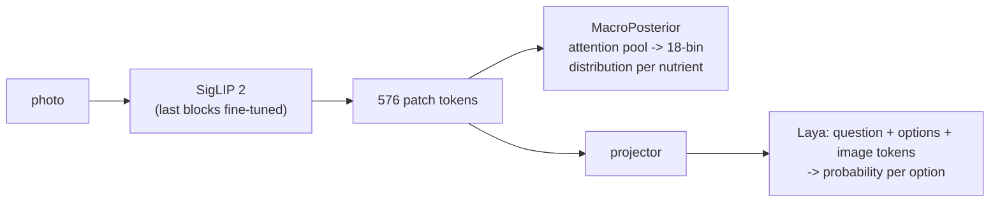

# LayaMacro

**One photo of a meal → calories, protein, carbohydrate, fat and food weight, each with an
honest uncertainty range.**

LayaMacro grafts an image encoder (SigLIP 2) onto [Laya](https://huggingface.co/convaiinnovations/laya),
an encoder-only *typed decision* model, so nutrition is answered as calibrated probability
distributions in a single forward pass, without generating text. Because Laya answers
questions written as text, the same mechanism can take new questions, such as
"Does this meal contain rice?", with no new weights (experimental; see below).

```
$ python scripts/infer/predict.py --weights weights/layamacro-macroposterior.pt meal.png

meal.png                                          true (weighed)
  energy          339.9 kcal (80 % range: 230-460)    362 kcal
  protein          18.2 g    (80 % range: 12-25)       22 g
  carbohydrate     27.5 g    (80 % range: 18-39)       24 g
  fat              16.9 g    (80 % range: 12-23)       20 g
  food weight     221.6 g    (80 % range: 177-275)    216 g
```

A Nutrition5k test dish the model never saw, chosen by a fixed rule: among test meals of
200-400 kcal, the one whose calorie error is closest to the median error (24 kcal). The
"true" column is not printed by the tool; it is the dataset's weighed label.

> **Research project, not a medical device.** Errors of 40-60 kcal per meal are typical on
> the kinds of photos it was trained on, and much larger on unfamiliar ones (see Limitations).

## Results at a glance

kcal mean absolute error (lower is better), mean of 2 seeds. Full tables, methods and
negative results: [docs/results.md](docs/results.md).

| model | Nutrition5k | never-seen meals | DFood-TJ (hospital trays) | NutritionVerse-Real (phone) |
|---|---|---|---|---|
| **LayaMacro MacroPosterior** | **41.4** | **56.7** | **57.0** | 130.3 |
| **LayaMacro Laya graft** | 45.7 | 59.8 | 61.0 | **121.6** |
| OmniFood8K (CVPR 2026, official weights)* | *36.8* | *50.5* | 168.9 | 639.3 |
| FoodLMM (7B, official weights)* | 48.6 | 66.2 | 209.3 | 684.7 |
| Gemma 4 E2B, untrained | 310.0 | 247.3 | 240.9 | 510.9 |

\* Run by us on the same test photos. They were trained on Nutrition5k only, so the last two
columns are transfer to new kinds of photos for them. On Nutrition5k itself, OmniFood8K is
better than LayaMacro.

- The 80 % ranges contain the true value 80-84 % of the time on these datasets.
- On datasets no model trained on, LayaMacro's best model beats OmniFood8K in every column,
  but every model, ours included, misjudges portion size on unfamiliar photos.

## How it works



Two models share the image encoder: **MacroPosterior** (a small head; best calorie accuracy,
fastest) and the **Laya graft** (answers typed questions; generalises best to unfamiliar
photos; can answer new questions). Details: [docs/architecture.md](docs/architecture.md),
and how the image is attached to Laya safely: [docs/laya.md](docs/laya.md).

## Install

Python 3.12, [uv](https://docs.astral.sh/uv/), a CUDA GPU recommended (CPU works for
inference, slowly).

```bash
git clone <this repository> && cd LayaMacro
uv sync                      # inference only
uv sync --extra train        # + training and benchmarks
```

## Use a trained model

Weights (CC BY-NC-SA 4.0, see [MODEL_LICENSE.md](MODEL_LICENSE.md)) are on Hugging Face:
`<HF-REPO>` *(to be filled in at release)*.

```bash
uv run python scripts/infer/predict.py --weights hf://<HF-REPO>/layamacro-macroposterior.pt meal.jpg
uv run python scripts/infer/predict.py --weights hf://<HF-REPO>/layamacro-laya.pt meal.jpg
```

```python
from layamacro.inference import load_predictor

model = load_predictor("hf://<HF-REPO>/layamacro-laya.pt")
model.predict(["meal.jpg"])   # {"kcal": {"value": ..., "low": ..., "high": ...}, ...}
```

**Asking other questions (experimental).** A Laya checkpoint can answer any question with
2-8 options: `model.ask(photos, "Does this meal contain rice?", ["yes", "no"])`, or
`--ask ... --options ...` on the command line. The released Laya checkpoint was trained on
nutrition questions only, and on food questions it was never trained on it answers **at
chance level** (docs/results.md, section 4). Treat its answers as a demonstration of the
mechanism, not as information about your meal.

Laya, SigLIP 2 and their tokenizers are downloaded from their official sources on first use.

## Train

```bash
# 1. data (see docs/datasets.md for licences)
uv run python scripts/data/download_nutrition5k.py
uv run python scripts/data/download_dfood_tj.py
uv run python scripts/data/download_nutritionverse.py   # needs a Kaggle API token

# 2. cache the frozen part of SigLIP 2 once
uv run python scripts/data/cache_features.py
uv run python scripts/data/cache_features.py --hidden-layer 12   # for MacroPosterior
uv run python scripts/data/cache_features.py --hidden-layer 20   # for Laya

# 3. train (writes runs/<name>/ and the weights)
uv run python scripts/train/train_macroposterior.py --tune-last 12 --seed 0        # ~1.5 h
uv run python scripts/train/train_laya.py --scope head --no-resampler \
    --images-per-batch 2 --epochs 10 --tune-last 4 --seed 0                          # ~12 h

# 4. release checkpoint (adds calibration temperatures)
uv run python scripts/export_weights.py --run runs/laya_s0 --out weights/my-laya.pt
```

Timings are for one RTX 4060 Ti (16 GB). Multi-task Laya on two GPUs:
`uv run torchrun --nproc_per_node 2 scripts/train/train_laya.py ... --multitask`.

## Benchmark

```bash
uv run python scripts/benchmark/evaluate.py         # every run on every test set
uv run python scripts/data/download_benchmark_datasets.py fpb lefood
uv run python scripts/benchmark/unseen.py           # datasets no model trained on
uv run python scripts/benchmark/question_bank.py --bank --run runs/<laya run>
uv run python scripts/benchmark/vlm.py --model gemma4-e2b   # an untrained VLM baseline
```

## Limitations

- **Portion size from one photo is guessed, not measured.** On unfamiliar photos every model
  we tested, ours included, predicts the portion sizes of its training data.
- **Uncertainty ranges are too narrow on unfamiliar photos**: they hold the truth 9-25 % of
  the time there, against 80-84 % on the training datasets.
- **Food recognition with Laya is not released yet**: multi-task training worked in one of
  two seeds and cost calorie accuracy (docs/results.md, section 4).
- Trained on cafeteria dishes (US), Chinese hospital meals and phone photos of mostly Western
  food. Other cuisines and settings are unfamiliar to it.

## Licence and credits

- **Code**: Apache License 2.0 ([LICENSE](LICENSE)).
- **Weights**: CC BY-NC-SA 4.0, non-commercial ([MODEL_LICENSE.md](MODEL_LICENSE.md)).
- Built on **Laya** by convaiinnovations and **SigLIP 2** by Google, trained on
  **Nutrition5k**, **DFood-TJ-F-Nutr** and **NutritionVerse-Real**: full credits in
  [NOTICE](NOTICE). LayaMacro is **not affiliated with or endorsed by** the authors of Laya
  or any of these works.
