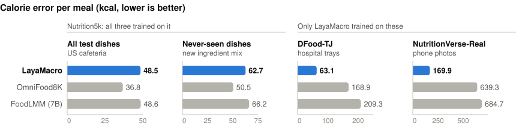
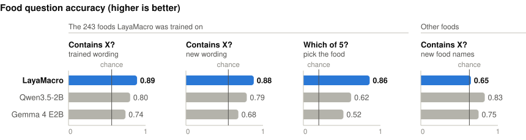
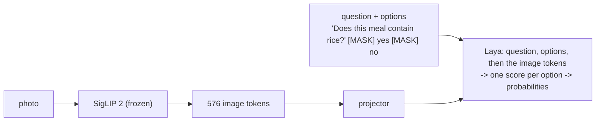

# LayaMacro

**One photo of a meal → calories, protein, carbohydrate, fat and food weight, each with an
honest uncertainty range, and answers to questions about the food.**

[](LICENSE)
[](MODEL_LICENSE.md)
[](https://huggingface.co/Aquos06/LayaMacro)


> **Research project, not a medical device.** Average calorie error is 48-63 kcal per meal on
> Nutrition5k and DFood-TJ test photos, 170 kcal on NutritionVerse-Real's larger meals, and
> worse on unfamiliar kinds of photos ([Limitations](#limitations)).

```
$ python scripts/infer/predict.py --weights weights/layamacro-laya.pt meal.png \
      --ask "Does this meal contain chicken?" --options yes no --over kcal=500

meal.png                                            true (weighed)
  energy          235.8 kcal (80 % range: 154-341)     276 kcal
  protein          29.1 g    (80 % range: 22-40)        52 g   <- outside the range
  carbohydrate      0.5 g    (80 % range: 0-2)           0 g
  fat              10.7 g    (80 % range: 2-26)          6 g
  food weight     145.9 g    (80 % range: 101-192)     167 g
  P(energy > 500 kcal) = 0%                              no
  Does this meal contain chicken? -> yes (yes 100%, no 0%)   yes
```

<sub>A Nutrition5k test dish the model never saw, picked by a fixed rule (median calorie error
among 200-400 kcal meals). The "true" column is the dataset's weighed label, not tool output.</sub>

## Results

<picture>
  <source media="(prefers-color-scheme: dark)" srcset="docs/figures/nutrition-dark.svg">
  
</picture>

OmniFood8K (CVPR 2026) and FoodLMM run by us from their official weights, on the same test
photos. On Nutrition5k OmniFood8K is clearly better; the right half is new to them, not to
LayaMacro.

<picture>
  <source media="(prefers-color-scheme: dark)" srcset="docs/figures/questions-dark.svg">
  
</picture>

Qwen3.5-2B and Gemma 4 E2B are general vision-language models, used as downloaded.

<details>
<summary>The same numbers as tables</summary>

| kcal error (lower is better) | Nutrition5k | never-seen dishes | DFood-TJ | NutritionVerse-Real |
|---|---|---|---|---|
| **LayaMacro** (released checkpoint) | 48.5 | 62.7 | **63.1** | **169.9** |
| OmniFood8K (CVPR 2026, official weights) | **36.8** | **50.5** | 168.9 | 639.3 |
| FoodLMM (7B, official weights) | 48.6 | 66.2 | 209.3 | 684.7 |
| Gemma 4 E2B, untrained | 310.0 | 247.3 | 240.9 | 510.9 |

| accuracy (chance) | "Contains X?" (0.56) | same, new wording (0.55) | "Which of 5?" (0.20) | "Contains X?", new foods (0.63) |
|---|---|---|---|---|
| **LayaMacro** | **0.89** | **0.88** | **0.86** | 0.65 |
| Qwen3.5-2B, untrained | 0.80 | 0.79 | 0.62 | **0.83** |
| Gemma 4 E2B, untrained | 0.74 | 0.68 | 0.52 | 0.75 |

</details>

Methods, more test sets and negative results: [docs/results.md](docs/results.md).

## How it works



An image encoder (SigLIP 2) grafted onto [Laya](https://huggingface.co/convaiinnovations/laya),
an encoder-only *typed decision* model. Every answer is a probability distribution over the
options, read in one forward pass with no generated text. Nutrition is five questions over 18
ranges each: the estimate is the mean, the range the central 80 %.
More: [docs/architecture.md](docs/architecture.md), [docs/laya.md](docs/laya.md).

## Quick start

Python 3.12 and [uv](https://docs.astral.sh/uv/); a CUDA GPU is recommended (CPU works, slowly).

```bash
git clone https://github.com/Aquos06/LayaMacro && cd LayaMacro && uv sync

W=hf://Aquos06/LayaMacro/layamacro-laya.pt   # 108 MB, downloaded on first use
uv run python scripts/infer/predict.py --weights $W meal.jpg                       # nutrition
uv run python scripts/infer/predict.py --weights $W meal.jpg --over kcal=500 fat_g=20
uv run python scripts/infer/predict.py --weights $W meal.jpg \
    --ask "Which of these foods is on this plate?" --options rice noodles bread potato salad
uv run python scripts/infer/predict.py --weights $W --foods                        # known foods
```

```python
from layamacro.inference import load_predictor

model = load_predictor("hf://Aquos06/LayaMacro/layamacro-laya.pt")
model.predict(["meal.jpg"])                     # {"kcal": {"value", "low", "high"}, ...}
model.prob_over(["meal.jpg"], "kcal", 500)      # e.g. [0.03]; calibrated
model.ask(["meal.jpg"], "Does this meal contain rice?", ["yes", "no"])
model.foods                                     # the 243 food names it was trained on
```

Works best for "Does this meal contain *X*?" and "Which of these foods is on this plate?" (up
to 8 options) with foods from `model.foods`, in any wording. For "over N kcal / grams", use
`--over` / `prob_over`: it is calibrated. Other foods and topics are answered, but weakly.

## Train and benchmark

<details>
<summary>Train the released recipe (~8.3 h on 2x RTX 4060 Ti)</summary>

```bash
uv sync --extra train

# 1. data (licences: docs/datasets.md)
uv run python scripts/data/download_nutrition5k.py
uv run python scripts/data/download_dfood_tj.py
uv run python scripts/data/download_nutritionverse.py   # needs a Kaggle API token

# 2. cache SigLIP 2's output once
uv run python scripts/data/cache_features.py

# 3. train: nutrition + food questions, 2 GPUs
uv run torchrun --nproc_per_node 2 scripts/train/train_laya.py --scope head --no-resampler \
    --images-per-batch 1 --epochs 10 --multitask --seed 0

# 4. release checkpoint (adds calibration temperatures, bins and the food list)
uv run python scripts/export_weights.py --run runs/laya_s0 --out weights/my-laya.pt
```

The recipe is unstable across seeds: check the food-question benchmark before using a run.

</details>

<details>
<summary>Run the benchmarks</summary>

```bash
uv run python scripts/benchmark/evaluate.py         # nutrition, every run on every test set
uv run python scripts/benchmark/question_bank.py --bank --run runs/<run>   # food questions
uv run python scripts/data/download_benchmark_datasets.py fpb lefood
uv run python scripts/benchmark/unseen.py           # datasets no model trained on
uv run python scripts/benchmark/vlm.py --model gemma4-e2b   # an untrained VLM baseline
```

</details>

## Limitations

- **Portion size is guessed, not measured.** On unfamiliar photos every model we tested
  predicts the portion sizes of its training data.
- **Ranges are too narrow on unfamiliar photos**: they hold the truth 13-23 % of the time
  there, against 79-92 % on the training datasets' test photos.
- **Only the 243 trained foods are recognised well** (chart above).
- **Training is unstable**: another seed of the same recipe failed to learn the food questions.
- **Food questions cost some calorie accuracy**: 46.0 → 49.1 kcal on Nutrition5k (mean of 2
  seeds).
- **Trained on** US cafeteria dishes, Chinese hospital meals and phone photos of mostly
  Western food; other cuisines are unfamiliar.

## Contributing

Bug reports, reproductions (especially other seeds) and poor-prediction reports are welcome:
see [CONTRIBUTING.md](CONTRIBUTING.md). Security problems: [SECURITY.md](SECURITY.md). Everyone
follows the [Code of Conduct](CODE_OF_CONDUCT.md).

## Licence and credits

- **Code**: Apache License 2.0 ([LICENSE](LICENSE)).
- **Weights**: CC BY-NC-SA 4.0, non-commercial ([MODEL_LICENSE.md](MODEL_LICENSE.md)).
- Built on **Laya** by convaiinnovations and **SigLIP 2** by Google, trained on
  **Nutrition5k**, **DFood-TJ-F-Nutr** and **NutritionVerse-Real**: full credits in
  [NOTICE](NOTICE). LayaMacro is **not affiliated with or endorsed by** the authors of Laya
  or any of these works.
