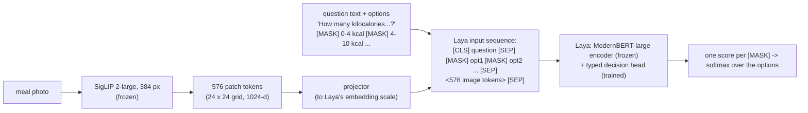

# Architecture

LayaMacro feeds an image into [Laya](https://huggingface.co/convaiinnovations/laya), an
encoder-only *typed decision* model. Laya answers questions written as text, each with a list
of options, by scoring every option and returning a probability distribution over them. Every
LayaMacro output, nutrition or food question, is such a distribution.

## Image encoder

`google/siglip2-large-patch16-384`, frozen. It turns the photo into 576 patch tokens of
1024 dimensions. Training caches them once (`scripts/data/cache_features.py`). The training
code can also fine-tune SigLIP 2's last blocks (`--tune-last k`); the released checkpoint does
not.

## The graft

- **Questions are text.** Each nutrition target is a `score` question whose 18 options are
  value ranges ("0 to 4.04 kcal", "4.04 to 9.72 kcal", …). Food questions are `choice` questions: "Does this meal
  contain rice?" (yes / no), "Which of these foods is on the plate?" (up to 8 options).
- **The image goes after the options.** Laya reads each option's answer at its `[MASK]`
  position by absolute index. Image tokens inserted *before* the options would shift every
  marker and give plausible, wrong answers with no error, so the image occupies placeholder
  slots after the final option `[SEP]`. The placeholder ids are written by Laya's own
  `build_sequence`; their embeddings are then overwritten with the projected image tokens.
  `model.check_invariants` asserts that markers land on `[MASK]` and the slots hold exactly
  what the projector wrote.
- **Laya's decision head is not modified**: answers come from its own `[MASK]`-per-option
  scorer. That is what lets one checkpoint take new questions without new weights.
- **One image, many questions**: the photo is encoded once and shared by all questions about
  it; each extra question costs one Laya pass over ~830 tokens.

## What was trained

| part | parameters | trained? |
|---|---|---|
| SigLIP 2-large | ~320 M | no |
| projector (to Laya's embedding scale) | 2.1 M | yes |
| Laya's ModernBERT-large encoder | ~395 M | no |
| Laya's decision head (2 transformer layers, scorer, type embedding) | 26.2 M | yes |

The released file holds only the trained parts (108 MB); the rest is downloaded from the
official SigLIP 2 and Laya releases.

## Training

- **Nutrition**: 5 `score` questions per photo (kcal, protein, carbohydrate, fat, weight), each
  over **18 bins** spaced evenly in log(value + offset), fitted once on the training split and
  frozen (`configs/target_bins.yaml`). Targets are HL-Gauss soft labels (a Gaussian of
  0.75 bins around the true value), trained with soft cross-entropy.
- **Food questions** (`--multitask`): 4 more questions per photo from the question bank
  (`layamacro.data.questions`), built from each dataset's recorded item lists: "contains X?"
  for a food on the plate and one that is not, "which of these 5 foods", and a threshold
  ("over 500 kcal?"). Cross-entropy, weighted 0.5 against the nutrition loss. Yes/no is a
  2-option `choice` with neutral keys A/B in random order, because Laya's `noul` type can
  follow its option text instead of the input. Fixed before training and never trained on:
  20 % of food names, one phrasing per question kind, and threshold questions on two of the
  three datasets, so the benchmark can test generalisation honestly.
- **Recipe**: 10 epochs, 2 photos per update (1 per GPU on 2 GPUs), AdamW with OneCycle,
  learning rate 3e-4 for the projector and 1e-4 for Laya's decision head.
- **Calibration**: one temperature per nutrition target, fitted on a calibration split that is
  neither train nor test, shipped inside the checkpoint.

## Size and speed (RTX 4060 Ti, bf16)

About 180 ms per photo for the five nutrition answers (measured on the test set), plus
~40 ms per extra question. Untested on phones: 8-bit weights would be ~0.75 GB, but every question is
a full Laya pass over ~830 tokens.
