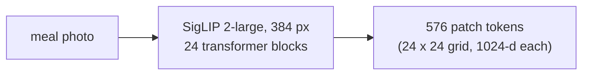
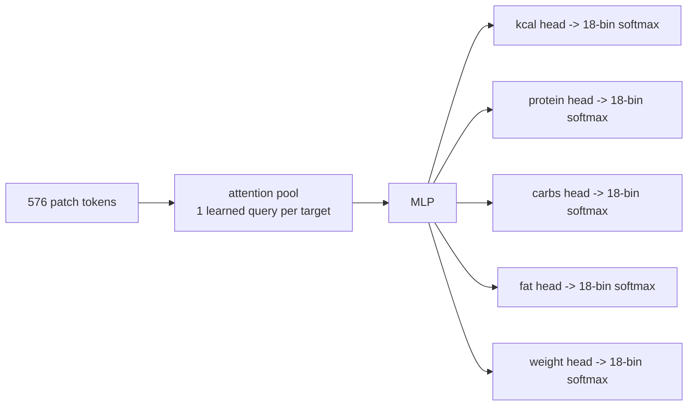
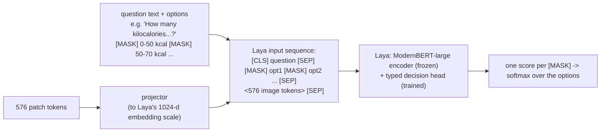

# Architecture

LayaMacro has two models that share one image encoder:

- **MacroPosterior**: a small dedicated head. Best calorie accuracy, fastest.
- **Laya graft**: the image fed into [Laya](https://huggingface.co/convaiinnovations/laya), an
  encoder-only *typed decision* model. It answers questions as probability distributions over
  options, so it can also answer questions it was not built for (ingredients, thresholds).

Both output, for each target (kcal, protein, carbohydrate, fat, food weight), a probability
distribution over **18 ranges** ("bins"). The estimate is the distribution's mean; the
**uncertainty range** is its central 80 %; a yes/no question like "over 500 kcal?" is the
probability mass above 500.

## Shared image encoder: SigLIP 2

`google/siglip2-large-patch16-384`. Its first blocks stay frozen; the last *k* blocks can be
trained with the head (`--tune-last k`: 12 for the released MacroPosterior, 4 for Laya).
Training caches the frozen blocks' output once (`scripts/data/cache_features.py`).

## MacroPosterior

Each target has its own learned query, so each attends to the patches that matter for it.
2.7 M parameters on a frozen encoder; 154 M with 12 trained SigLIP 2 blocks.

## Laya graft

- **Questions are text.** Each nutrition target is a `score` question whose 18 options are the
  ranges. Other questions are `choice` questions: "Does this meal contain rice?"
  (yes / no), "Which of these foods is on the plate?" (5 options). A new question needs no
  new weights: write its text and options.
- **The image goes after the options.** Laya reads each option's answer at its `[MASK]`
  position by absolute index. Image tokens inserted *before* the options would shift every
  marker and produce plausible, wrong numbers with no error, so the image occupies reserved
  placeholder slots in the state region after the final option `[SEP]`. The placeholder ids
  are written by Laya's own `build_sequence`, then their embeddings are overwritten with the
  projected image tokens. Every batch can assert that markers land on `[MASK]` and the slots
  hold exactly what the projector wrote (`model.check_invariants`).
- **Laya's decision head is not modified**: answers come from its own `[MASK]`-per-option
  scorer, which is what keeps "new questions without retraining" possible.
- **One image, many questions**: the photo is encoded once and shared by all questions about
  it; each extra question costs one Laya pass over ~830 tokens.
- **Multi-task** (`--multitask`): besides the 5 nutrition questions, each photo gets ingredient,
  which-food and threshold questions built from the datasets' recorded item lists
  (`layamacro.data.questions`). Held-out food names and phrasings are never trained on, so the
  benchmark can test new questions honestly.

## Training targets and calibration

- **Bins**: 18 per target, spaced evenly in log(value + offset), fitted once on the training
  split (`configs/target_bins.yaml`) and frozen.
- **Labels**: HL-Gauss soft labels (a Gaussian of 0.75 bins around the true value), soft
  cross-entropy loss.
- **Calibration**: one temperature per target, fitted on a calibration split that is neither
  train nor test. Released checkpoints carry these temperatures.

## Sizes and speed (RTX 4060 Ti, bf16)

| | parameters | time per photo, after the image encoder |
|---|---|---|
| SigLIP 2-large encoder | ~320 M | shared |
| MacroPosterior head | 2.7 M (+150 M trained encoder blocks) | ~5 ms for all 5 targets |
| Laya graft | ~420 M (Laya) + projector | ~190 ms for 5 questions, ~40 ms per extra question |
